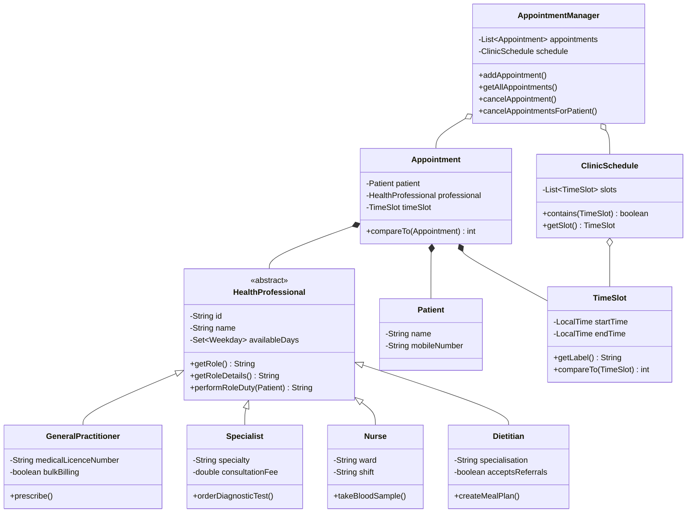
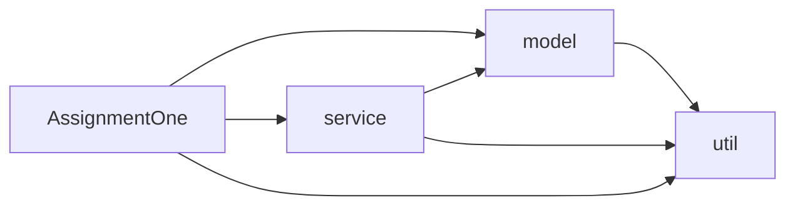

# PROG2004 Assessment 1 — Design Notes

## 1. Purpose and scope

This project is a small appointment system for a health service. It models
health professionals, patients, appointment slots, and the clinic's booking
rules.

The assignment deliberately does **not** require a finished application. There
is no menu, no login, no user input, and no database. The program is a scripted
console simulation: `AssignmentOne.main()` creates objects, calls their
methods, and prints the results.

The design therefore focuses on:

- a clear set of domain classes;
- correct use of encapsulation, inheritance, polymorphism, and abstraction;
- a small, explainable implementation that stays within Modules 1–3;
- rules that prevent invalid appointments.

## 2. Package structure

```text
src/
├── AssignmentOne.java                 # entry point / demonstration (default package)
├── model/                             # domain model
│   ├── HealthProfessional.java        # abstract base class
│   ├── GeneralPractitioner.java
│   ├── Specialist.java
│   ├── Nurse.java
│   ├── Dietitian.java
│   ├── Patient.java
│   ├── TimeSlot.java
│   ├── ClinicSchedule.java
│   └── Appointment.java
├── service/                           # business logic
│   └── AppointmentManager.java
└── util/                              # shared helpers
    ├── Validation.java
    └── Weekday.java
```

The packages separate three concerns:

| Package | Responsibility | Depends on |
|---|---|---|
| `model` | What the system is about: professionals, patients, slots, appointments | `util` |
| `service` | What the system can do: booking rules and appointment management | `model`, `util` |
| `util` | Shared validation and the weekday enum | Java standard library |

`AssignmentOne` is kept in the default package so the project can be started
with `java -cp out AssignmentOne`. It depends on all three packages, but no
model or service class depends on the demonstration class.

## 3. Class responsibilities

| Class | Responsibility |
|---|---|
| [`AssignmentOne`](../src/AssignmentOne.java) | Creates the demonstration objects, calls the manager, and prints results. |
| [`HealthProfessional`](../src/model/HealthProfessional.java) | Abstract parent holding the common ID, name, and working days; defines the abstract role methods and the shared `toString()`/`equals()`. |
| [`GeneralPractitioner`](../src/model/GeneralPractitioner.java) | Adds a medical licence and bulk-billing flag; can prescribe medication. |
| [`Specialist`](../src/model/Specialist.java) | Adds a specialty and consultation fee; can order a diagnostic test. |
| [`Nurse`](../src/model/Nurse.java) | Adds a ward and shift; can take a blood sample. |
| [`Dietitian`](../src/model/Dietitian.java) | Adds a specialisation and referral setting; can create a meal plan. |
| [`Patient`](../src/model/Patient.java) | Immutable patient name and mobile number. |
| [`TimeSlot`](../src/model/TimeSlot.java) | One fixed 30-minute slot; stores `LocalTime` values and supports comparison and equality. |
| [`ClinicSchedule`](../src/model/ClinicSchedule.java) | Generates the fixed 08:00–16:00 schedule and checks whether a slot is valid. |
| [`Appointment`](../src/model/Appointment.java) | Composition of patient, professional, and time slot; supports time ordering and readable output. |
| [`AppointmentManager`](../src/service/AppointmentManager.java) | Stores appointments in an `ArrayList` and enforces adding, filtering, sorting, and cancellation rules. |
| [`Validation`](../src/util/Validation.java) | Shared blank-value and numeric-ID checks. |
| [`Weekday`](../src/util/Weekday.java) | Enum for the seven working days and conversion from `DayOfWeek`. |

## 4. Object collaboration

```text
AssignmentOne
│
├── List<HealthProfessional>
│     ├── GeneralPractitioner
│     ├── Specialist
│     ├── Nurse
│     └── Dietitian
│
├── ClinicSchedule ── List<TimeSlot>
│
└── AppointmentManager
      ├── List<Appointment>
      └── Appointment
            ├── Patient
            ├── HealthProfessional
            └── TimeSlot
```

This is a **runtime object graph**, not a folder tree. For example,
`List<HealthProfessional>` is a field inside `AssignmentOne`; it is not a
package. `Appointment` contains a `Patient`, a `HealthProfessional`, and a
`TimeSlot` through composition.

The same relationships as a Mermaid class diagram:



Package dependencies are one-way:



GitHub renders Mermaid blocks. If a local Markdown viewer does not, the ASCII
diagram above conveys the same relationships.

## 5. Design decisions by part

### Part 1 — Modelling a health professional

`HealthProfessional` is abstract because a professional must have a concrete
role; a plain `HealthProfessional` object would not know what kind of
professional it represents.

Common state is stored in private fields:

- `id` — numeric only, validated by `Validation.requireNumeric()`;
- `name` — non-blank, validated by `Validation.requireNonBlank()`;
- `availableDays` — a `Set<Weekday>` copied into a `LinkedHashSet` in
  Monday-to-Sunday order and wrapped with `Collections.unmodifiableSet()`.

The class is immutable: all three fields are `final`, and there are no setters.
External code can read the values through getters but cannot put the object into
an invalid state. The unmodifiable set also prevents callers from changing the
professional's availability by accident.

`equals()` and `hashCode()` use the ID only. This matches the domain identity:
two objects with the same professional ID represent the same professional, even
if they are different Java objects. The manager relies on this when checking for
double bookings.

`toString()` is a small template method. It prints the common fields and then
calls the abstract `getRoleDetails()`. Each subclass supplies only its extra
details, so the output format stays consistent without duplicating the whole
method in four classes.

Only one constructor is provided. The caller must supply the working days
explicitly. This avoids an ambiguous default schedule and keeps the demo
readable; the main method builds the working-day sets with a small helper.

### Part 2 — Specialising health professionals

The four concrete types reuse `HealthProfessional` and add only what is
different:

| Type | Extra fields | Unique behaviour |
|---|---|---|
| `GeneralPractitioner` | medical licence, bulk billing | `prescribe(...)` |
| `Specialist` | specialty, consultation fee | `orderDiagnosticTest(...)` |
| `Nurse` | ward, shift | `takeBloodSample(...)` |
| `Dietitian` | specialisation, accepts referrals | `createMealPlan(...)` |

Each subclass:

- calls `super(id, name, availableDays)` so the common data is validated once;
- stores its own fields as `final`;
- implements `getRole()`, `getRoleDetails()`, and `performRoleDuty(Patient)`;
- provides one constructor with all required values.

There is no `Doctor` intermediate class. Only two types are doctors, and adding
another level would add complexity without changing the behaviour needed for the
assignment. There is also no `Prescriber` interface; only the GP currently
prescribes. Both are reasonable future extensions, not current requirements.

### Part 3 — Working with health professional objects

All professionals are stored in one `List<HealthProfessional>`:

```java
List<HealthProfessional> professionals = new ArrayList<>();
professionals.add(gp1);
professionals.add(specialist1);
professionals.add(nurse1);
professionals.add(dietitian1);
```

The loop variable has the parent type, but the actual objects are subclasses.
Calling `toString()` or `performRoleDuty()` therefore runs the subclass version
at runtime. This is the main demonstration of polymorphism.

The demo creates three GPs and one of each other type: enough to show a
realistic mix without making the output unnecessarily long.

### Part 4 — Modelling an appointment

`Patient` is a separate class because a patient is a real domain object with
its own data and validation. If the name and phone were stored directly in
`Appointment`, the same fields would be repeated and patient logic would be
mixed with booking logic. `Patient` is immutable and stores the mobile number
as supplied.

`TimeSlot` represents one fixed 30-minute interval. It stores `LocalTime`
values rather than strings so comparison and sorting are correct. It implements
`Comparable<TimeSlot>` and overrides `equals()`/`hashCode()` because the clinic
schedule and the duplicate-booking check need to compare slots by value.

`ClinicSchedule` owns the fixed daily schedule. The opening time, closing time,
and slot length are private constants. The constructor generates the slots once
and stores them in an unmodifiable list. `contains()` checks whether a slot is
part of the schedule, and `getSlot()` returns the canonical slot for a requested
time. If the clinic day changes, only the constants need to be edited.

`Appointment` uses composition rather than inheritance:

```java
private final Patient patient;
private final HealthProfessional professional;
private final TimeSlot timeSlot;
```

The professional field is the abstract parent type, so one `Appointment` class
works with every professional type. The date is not stored because bookings are
only for the current day. `Appointment` implements `Comparable` by comparing
time slots, which lets the manager sort a list with `Collections.sort()`.

`Appointment` does not override `equals()`/`hashCode()` because the current
code never uses appointment objects as keys or compares them for duplicate
identity. The manager compares the professional and the time slot directly.

### Part 5 — Managing the appointment collection

`AppointmentManager` uses an `ArrayList<Appointment>` because appointments need
to be:

- displayed in time order;
- filtered by professional or patient;
- added and removed frequently.

No key-based lookup is required, so a `HashMap` would add complexity without a
benefit.

The add operation checks, in order:

1. patient, professional, and time slot are not `null`;
2. the professional works today (`Weekday.today()`);
3. the slot belongs to the clinic schedule (`ClinicSchedule.contains()`);
4. the same professional is not already booked in the same slot.

Only after all checks pass does it create an `Appointment` and add it to the
list. Business failures return a `WARNING` string; they are expected outcomes,
not program errors.

Filtering methods create a new list of matches, sort it, and return an
unmodifiable copy. Sorting is implemented by `Appointment.compareTo()`, which
delegates to `TimeSlot.compareTo()`.

Cancellation supports two forms:

- by professional ID and time slot — removes one matching appointment;
- by patient mobile number — removes all matching appointments and reports how
  many were removed.

The methods use ordinary index loops rather than `Iterator`, keeping the code
close to the collections material. Invalid cancellation attempts return
`WARNING` messages and do not change the list.

The manager never prints. It returns a message, and `AssignmentOne` decides how
to display it. This keeps the business logic reusable and testable.

### Part 6 — Demonstrating the system

`AssignmentOne` demonstrates:

- creation of six professionals across four types;
- type-specific behaviour;
- polymorphic calls through `List<HealthProfessional>`;
- seven successful bookings across different professional types;
- duplicate booking, outside-schedule booking, and unavailable-professional
  warnings;
- filtering by professional ID and patient phone;
- cancellation by professional ID + time;
- cancellation of all appointments for a patient;
- invalid cancellation cases;
- the final appointment count.

The demo prints 7 successful bookings, 3 booking warnings, 2 cancellation
operations (3 appointments removed), 3 cancellation warnings, and 4 remaining
appointments.

## 6. The four OOP pillars

| Pillar | Where it appears | Why it is used |
|---|---|---|
| Encapsulation | `HealthProfessional`, `Patient`, `TimeSlot`, `Appointment`, `ClinicSchedule` keep fields private and validate values in constructors; collections are returned as unmodifiable views. | Prevent invalid states and stop external code from changing the schedule or availability accidentally. |
| Inheritance | `GeneralPractitioner`, `Specialist`, `Nurse`, and `Dietitian` extend `HealthProfessional`. | Reuse the common ID, name, and working-day logic instead of copying it into four classes. |
| Polymorphism | `List<HealthProfessional>`; `toString()` and `performRoleDuty()` calls through the parent type; `Appointment` accepts any `HealthProfessional`. | Let the same loop or booking method work with every professional type and let each object respond in its own way. |
| Abstraction | `HealthProfessional` is abstract; `getRole()`, `getRoleDetails()`, and `performRoleDuty()` are abstract methods; `Comparable` abstracts the ordering contract. | Force each concrete type to provide its role-specific behaviour and hide unnecessary implementation details. |

## 7. Conscious simplifications

The project deliberately avoids features that are outside the assignment scope:

- **Fixed 30-minute slots** — no custom duration or generic overlap algorithm.
  Duplicate bookings are detected by comparing the same `TimeSlot`.
- **Current-day bookings only** — `Appointment` does not store a date.
- **Exact mobile-number matching** — no `+61` conversion, spacing normalisation,
  or formatting. The demo uses one consistent format.
- **One constructor per subclass** — no default-attribute overloads. The caller
  supplies all values explicitly.
- **No `equals()`/`hashCode()` on `Patient` or `Appointment`** — they are not used
  as collection keys or for identity checks in the current design.
- **No interfaces, factories, repositories, or persistence** — the assignment
  asks for a small model, not a production application.
- **Default package for the entry class** — keeps the run command simple; the
  domain, service, and utility classes are in packages.

`Weekday` and `LocalTime` are kept because they directly support two assignment
requirements: a fixed set of working days and correct ordering by time.

## 8. Extensibility

The design leaves several natural extension points:

1. **New professional type** — extend `HealthProfessional`, implement the three
   abstract methods, and add the new unique fields/behaviour. `Appointment` and
   `AppointmentManager` need no changes.
2. **Different schedule** — change the constants in `ClinicSchedule`. If runtime
   configuration is needed later, add a constructor that accepts opening time,
   closing time, and slot length.
3. **Graphical interface** — keep the model and manager; replace
   `AssignmentOne` with a UI that calls the same methods and displays the
   returned messages.
4. **Persistence** — add a repository class that saves and loads appointments;
   the domain classes do not need to know where the data is stored.
5. **Prescribing specialists** — introduce a `Prescriber` interface and have
   both doctor types implement it. This is intentionally not included now to
   keep the hierarchy small.

## 9. Build, run, and verification

```bash
javac -Xlint:all -d out src/AssignmentOne.java src/model/*.java src/service/*.java src/util/*.java
java -cp out AssignmentOne
```

The code compiles with no warnings under `-Xlint:all`, and the Javadoc passes
`-Xdoclint:all`. The demo output is checked by running the program; the expected result
summary is recorded in the test plan.

Because the demo uses `Weekday.today()`, the “available days” printed for each
professional and the day named in the unavailable-professional warning depend on
the day the program is run. The schedule times, booking rules, and final count
remain the same.
